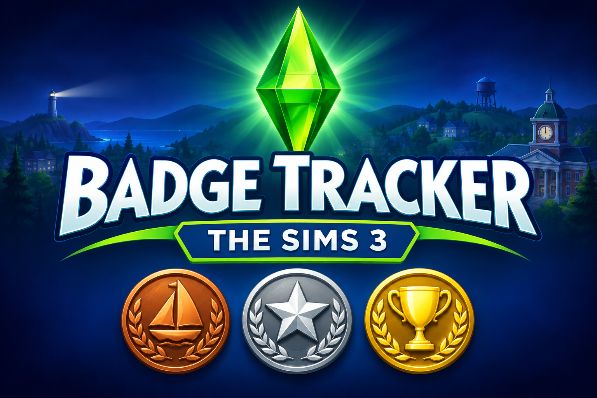

# Badge Tracker for The Sims 3

Badge Tracker adds an achievement panel to The Sims 3 Steam 1.67 on Windows. Load a household and press **Ctrl + Shift + B** to open it.

## Features

- **Browse and filter.** Search by name or filter by installed pack, medal tier, or completion status. Cards show the description and original badge artwork when available.
- **Track progress.** See the current count, goal, and remaining steps for supported achievements with a readable counter. Progress is refreshed when you reopen the panel. Resume Live Mode after a purchase before checking the count again.
- **Pin achievements.** Select **Pin**, then **Track pinned badges** to display full cards over the game. Drag the cards with the left mouse button. Right-click a card to return to the main panel.
- **Get completion alerts.** When the game records a new achievement, the mod displays a notification and plays a chime. If the pinned card is visible, it lights up and plays the shorter chime instead. Use **Sound** to preview both sounds, adjust the volume, or mute them.
- **Pick up where you left off.** The panel remembers your search, filters, selected tab, and scroll position. It also saves pinned badges and the position of their cards.
- **Language support.** The panel detects the game's language and offers English and Brazilian Portuguese menus. Other game languages use English menus and achievement text provided by the game when available.

## Offline access and EA sign-in

You can browse the bundled catalog of original The Sims 3 achievements associated with TheSims3.com without signing in or connecting to the internet. Descriptions, available badge artwork, and filtering by installed packs are available offline, including for players who have never signed in.

Completion status and progress come from the game. If the game has no status for a catalog entry, the panel shows **Progress unavailable**. That can happen on a fresh profile or when achievement data has not loaded. A badge may appear in the catalog before the game starts tracking it. Notifications appear only after the game reports a completion.

**EA sign-in is optional.** Signing in inside The Sims 3 can help if you already have achievement history associated with your EA profile. The mod displays that history when the game makes it available. Badge Tracker reads the game's achievement state and leaves account synchronization to the game.

## Screenshots

These screenshots show the actual Badge Tracker interface with sample progress.

## Build

Use Python 3.10+, the .NET Framework 3.5 compiler, and an x86 Visual Studio Developer Command Prompt. Clone Dear ImGui v1.92.8 into work/imgui. Supply your own installed game files when extracting build references.

    python -B tools/references.py "PATH_TO_THE_SIMS_3" work/refs
    python -B tools/build.py work/refs
    build-native.cmd

The builds directory contains catalog and artwork inputs. The native build compiles the viewer, then embeds it and the assets in the ASI. Distribute the ASI and package under the names BadgeTracker.asi and BadgeTracker.package.

## AI disclosure

OpenAI Codex assisted with C# and C++ development, debugging, interface implementation, and build scripts. The Mod The Sims cover was AI-generated. The interface screenshots show the actual viewer with sample data.

The Sims 3 artwork belongs to its respective rights holders. See LICENSE-imgui.txt for Dear ImGui.

