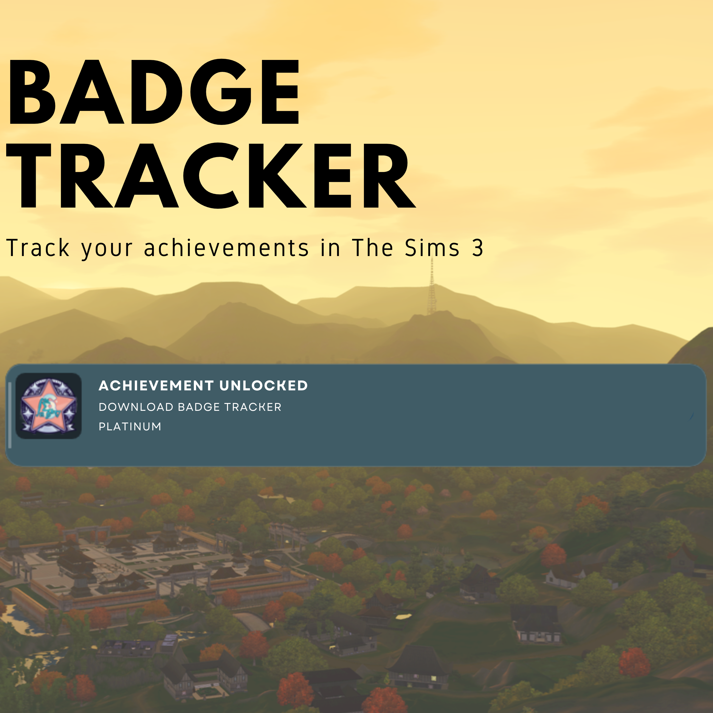
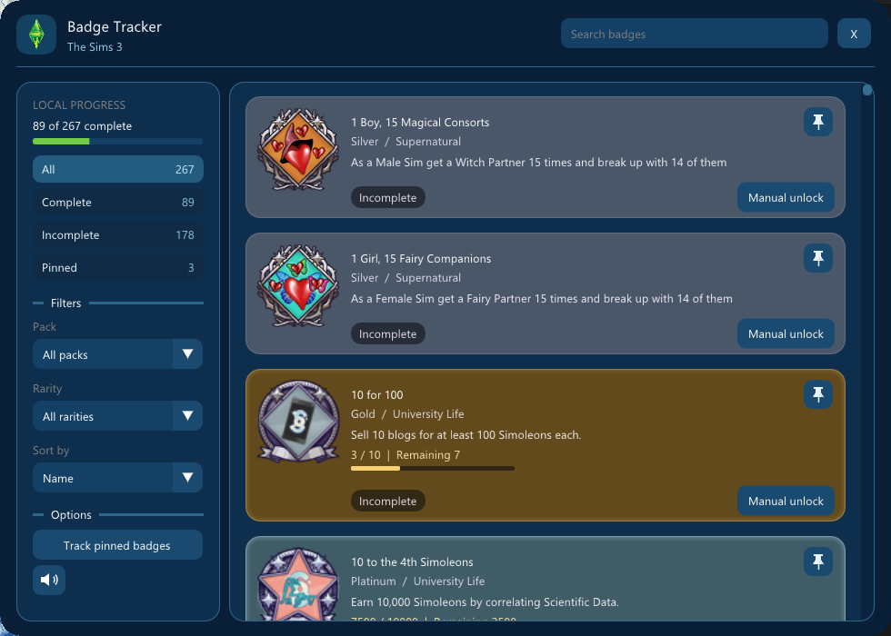
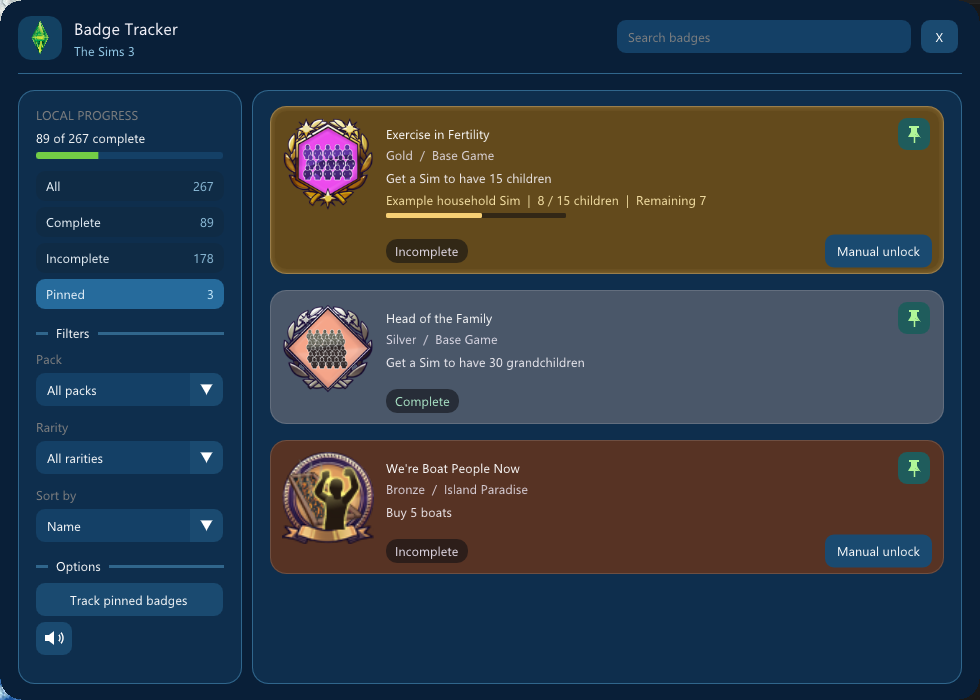
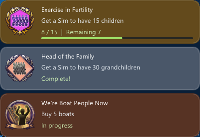

# Badge Tracker: Rediscover The Sims 3’s achievement badges

A lot of players don’t know this, but The Sims 3 has a whole achievement system. Its badges give you new reasons to revisit an old save, try a different playstyle, or explore an expansion you haven’t played much. The built-in badge browser requires you to sign into EA in-game, and playing online can sometimes make the game feel sluggish.

**Badge Tracker** brings the badge catalog from the official TheSims3.com website directly into your game. Browse the original badges, pick a challenge, and pin it on screen while you play. The catalog is available offline, and you can use the same panel if you prefer to stay signed into EA.

Press **Ctrl + Shift + B** during gameplay to open the panel.

## Features

- **Find your next challenge.** Search by name or filter by expansion pack, rarity, and completion status. The catalog shows badges for the packs your game recognizes.
- **See how close you are.** View original badge artwork, descriptions, and progress bars where the game provides a readable counter. Sort incomplete badges with a progress bar by highest or lowest progress.
- **Keep a badge on screen.** Pin a card with its artwork and description, then drag it wherever you want. Right-click the card to return to the full panel.
- **Celebrate an unlock (Steam edition).** Get a notification and a chime when the game registers an achievement. If its pinned card is visible, the card lights up and plays a shorter chime.
- **Mark a bugged badge complete.** If you meet the requirements and the game still doesn’t award the badge, use Manual Unlock to mark it complete locally in Badge Tracker. Your EA account and online badges are unaffected.

## Download and installation

- [EA App 1.69.47, BadgeTracker v0.3.0](https://github.com/Jindevils/Sims3-BadgeTracker/releases/tag/v0.3.0)
- [Steam 1.67, BadgeTracker v0.2.0](https://github.com/Jindevils/Sims3-BadgeTracker/releases/tag/v0.2.0)

1. Close the game and extract the download for your edition.
2. Copy BadgeTracker.asi to Game/Bin, beside TS3.exe for EA App or TS3W.exe for Steam.
3. Copy BadgeTracker.package to Documents/Electronic Arts/The Sims 3/Mods/Packages.
4. A 32-bit ASI loader is required. The EA download includes dinput8.dll for Game/Bin. Check an existing loader before replacing it.
5. Start through EA App or Steam, load a household and press **Ctrl + Shift + B**.

English and Brazilian Portuguese guides are included. The Mods folder can be shared by both editions. Switch packages when switching editions.

## What’s new in v0.3.0

- Added a dedicated EA App 1.69.47 edition including the 32-bit ASI loader dinput8.dll. The Steam download remains v0.2.0.
- Read completed achievement history independently of active challenges. After signing into EA in-game, allow synchronization, wait about 30 seconds in Live Mode, then close and reopen the panel. A restart is normally unnecessary.
- Replaced repeated unavailable-progress labels with a warning icon beside volume in the EA App panel. Hover or click for English or Brazilian Portuguese guidance.
- Corrected EA exports with compact records and terminated blocks. Reduced checks to every 30 seconds and export only changed snapshots.
- Bring an existing panel window back to the foreground when the shortcut is pressed again.

**Updating the EA App edition:** Close the game and replace both BadgeTracker.asi in Game/Bin and BadgeTracker.package in Mods/Packages. The download includes dinput8.dll. Use it if you need a loader and check an existing loader before replacing files.

**Validation:** Opening, reopening and some completed achievements were confirmed in the author's EA App installation. Native reader tests covered 265 records, Unicode, block terminators, invalid input and reopening a test window. The newest warning interface was checked in the preview and awaits in-game confirmation.

**EA limitations:** Individual progress counters need validation. Completion notifications and live updates to open pinned cards remain pending. The transport currently retains its marked ScriptError XML exports.

[Full changelog](CHANGELOG.md)

## Saved preferences and languages

- **Pick up where you left off.** The panel remembers your search, filters, selected tab, and scroll position. It also saves pinned badges and the position of their cards.
- **Language support.** The panel detects the game's language and offers English and Brazilian Portuguese menus. Other game languages use English menus and achievement text provided by the game when available.

## Offline access and EA sign-in

You can browse the bundled catalog of original The Sims 3 achievements associated with TheSims3.com without signing in or connecting to the internet. Descriptions, available badge artwork, and filtering by installed packs are available offline, including for players who have never signed in.

Completion status and progress come from the game. If the game has no status for a catalog entry, the EA App panel leaves the status blank and shows a warning beside volume. Steam v0.2.0 shows **Progress unavailable**. That can happen on a fresh profile or when achievement data has not loaded. A badge may appear in the catalog before the game starts tracking it. Steam notifications appear after the game reports a completion. EA notifications remain pending.

**EA sign-in is optional.** Signing in inside The Sims 3 can help if you already have achievement history associated with your EA profile. The mod displays that history when the game makes it available. Badge Tracker reads the game's achievement state and leaves account synchronization to the game.

## Screenshots

These screenshots show the actual Badge Tracker interface with sample progress.

## Build

Use Python 3.10+, the .NET Framework 3.5 compiler, and an x86 Visual Studio Developer Command Prompt. Clone Dear ImGui v1.92.8 into work/imgui. Supply your own installed game files when extracting build references.

    python -B tools/references.py "PATH_TO_THE_SIMS_3" work/refs
    python -B tools/build.py work/refs
    build-native.cmd

The builds directory contains catalog and artwork inputs. The native build compiles the viewer, then embeds it and the assets in the ASI. Distribute the ASI and package under the names BadgeTracker.asi and BadgeTracker.package.

For the EA edition, prepare the same references and Dear ImGui checkout and run build-ea169.cmd from an x86 Visual Studio Developer Command Prompt. Sources are in ea169/.

## AI disclosure

OpenAI Codex assisted with C# and C++ development, debugging, interface implementation, and build scripts. The Mod The Sims cover was AI-generated. The interface screenshots show the actual viewer with sample data.

The Sims 3 artwork belongs to its respective rights holders. See LICENSE-imgui.txt for Dear ImGui.

