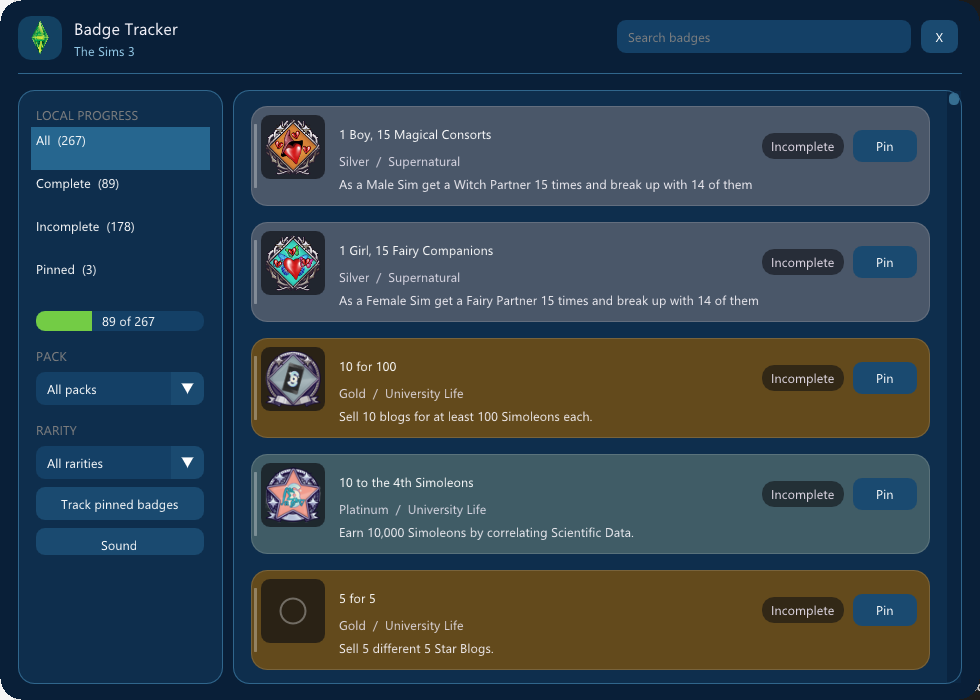
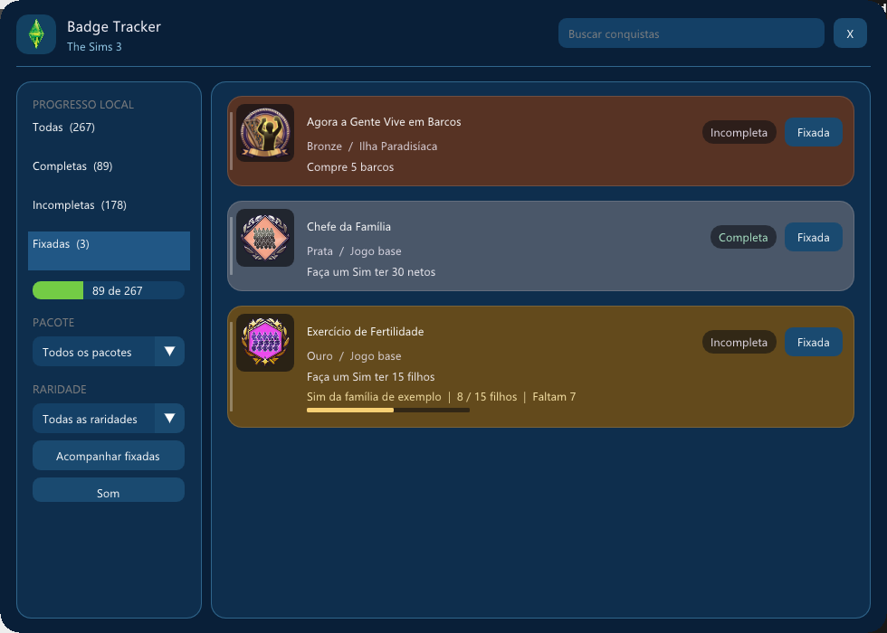
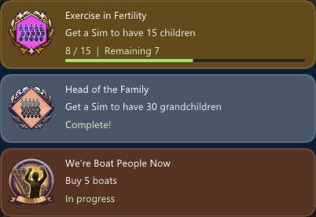

# Badge Tracker for The Sims 3

An achievement tracker for The Sims 3 Steam 1.67 on Windows. Press Ctrl+Shift+B during gameplay. The managed script reads achievement data, the ASI handles the shortcut, and the embedded viewer displays the catalog and notifications.

## Screenshots

These screenshots show the actual Badge Tracker interface with sample progress.

## Build

Use Python 3.10+, the .NET Framework 3.5 compiler, and an x86 Visual Studio Developer Command Prompt. Clone Dear ImGui v1.92.8 into work/imgui. Supply your own installed game files when extracting build references.

    python -B tools/references.py "PATH_TO_THE_SIMS_3" work/refs
    python -B tools/build.py work/refs
    build-native.cmd

The builds directory contains catalog and artwork inputs. The native build compiles the viewer, then embeds it and the assets in the ASI. Distribute the ASI and package under the names BadgeTracker.asi and BadgeTracker.package.

## AI disclosure

OpenAI Codex assisted with C# and C++ development, debugging, interface implementation, and build scripts. The Mod The Sims cover was AI-generated. The interface screenshots show the actual viewer with sample data.

The Sims 3 artwork belongs to its respective rights holders. See LICENSE-imgui.txt for Dear ImGui.

